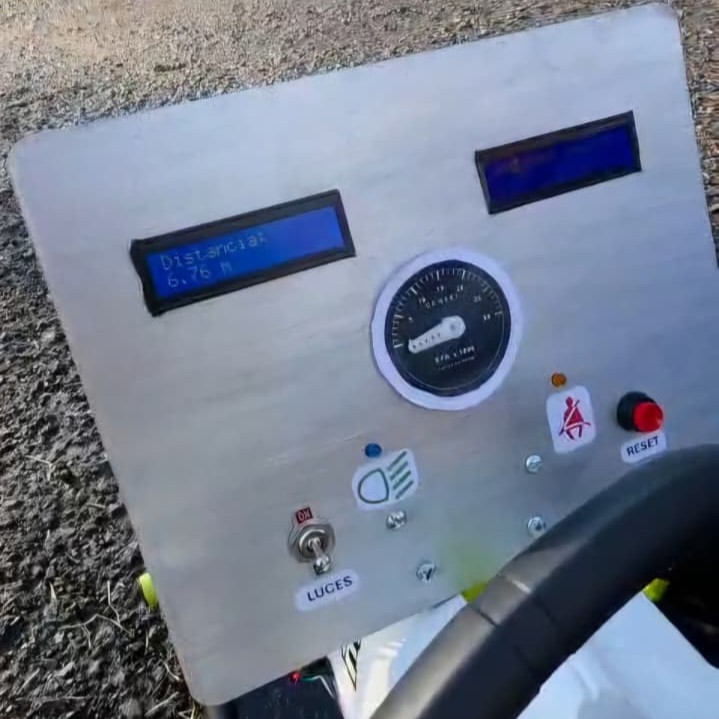
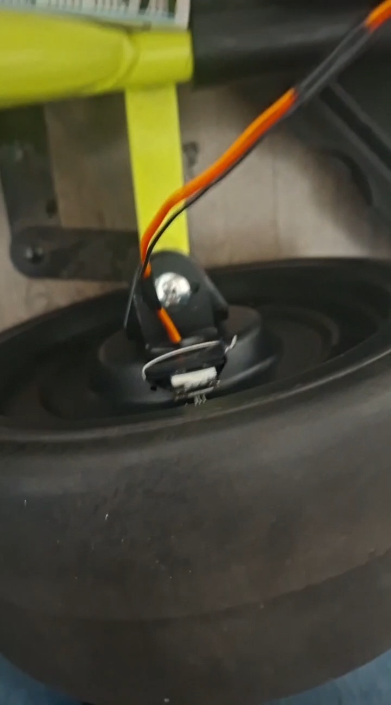
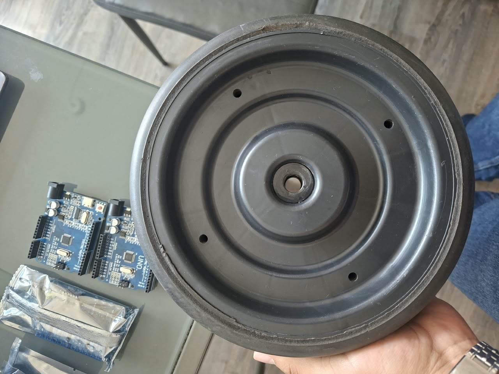
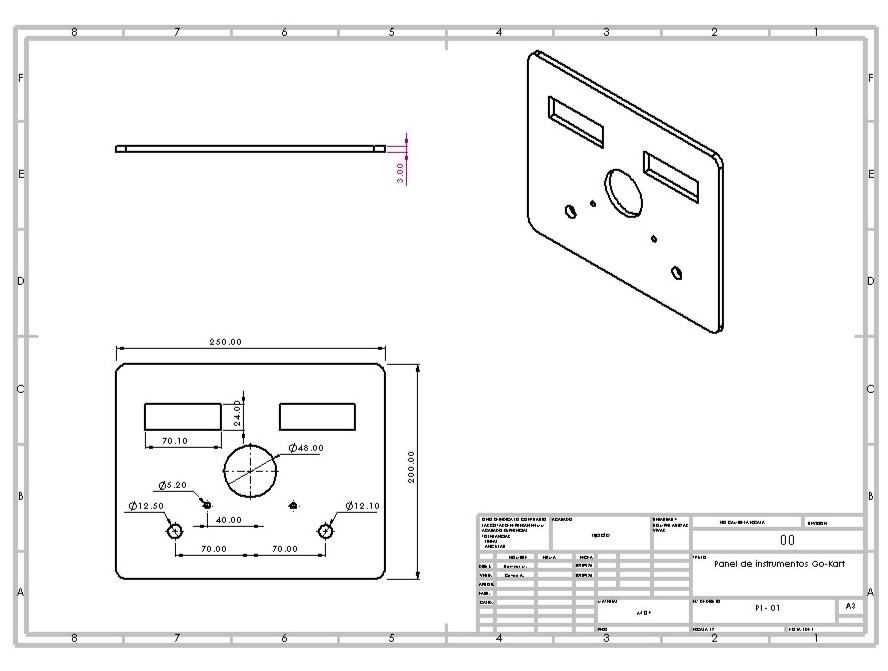

# Go-kart Instrument Panel

Arduino Uno-based instrumentation for an electric go-kart, featuring travel distance measurement and motor RPM estimation.

## Overview

The system uses a front-wheel Hall sensor to detect wheel rotation, calculate travel distance and estimate motor speed.

A 16 × 2 I2C LCD displays travel distance, while a servo-driven tachometer represents estimated motor RPM. A push button resets the trip distance.

The instrument panel consists of a 300 × 200 mm MDF base designed in SolidWorks.

## Features

- Front-wheel pulse detection using a KY-003 Hall sensor.
- Four magnets per wheel revolution.
- Travel distance display in metres.
- Motor RPM estimation from wheel rotation.
- Analog tachometer with a 0–25,000 RPM scale.
- Push-button trip reset.
- Serial output for pulse counts, distance and RPM.

## Hardware

- Arduino Uno.
- KY-003 Hall sensor.
- Four wheel-mounted magnets.
- 16 × 2 I2C LCD.
- Tachometer servomotor.
- Momentary reset button.

## Hardware Integration

### Hall Sensor Mounting

### Wheel Magnet Layout

### Instrument Panel Engineering Drawing

## Software and Design Tools

- Arduino C++.
- Wire library.
- LiquidCrystal_I2C library.
- Servo library.
- SolidWorks.

## Repository Structure

- `firmware/` — Arduino source code.
- `cad/` — Panel model and manufacturing files.
- `docs/` — Connections, calculations and technical details.
- `media/` — Photographs and demonstrations.

## Documentation

See [Technical Documentation](docs/technical_documentation.md) for system operation, connections and calculations.

## Measurement Scope

Travel distance is calculated from front-wheel pulses.

Motor RPM is an indirect estimate based on wheel geometry and a provisional motor-to-rear-wheel reduction of 95:1. The calculation assumes rolling without slip.

## Author

Miguel Ángel Ramírez Mosqueda  
Automotive Systems Engineering  
UPIITA — Instituto Politécnico Nacional