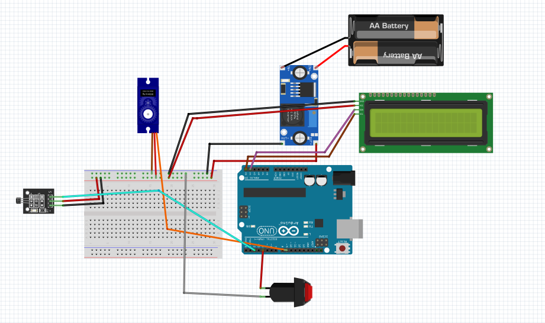

# Technical Documentation

## System Description

The instrument panel combines travel distance measurement and motor RPM estimation on an Arduino Uno.

A KY-003 Hall sensor detects four magnets installed on the front wheel. The resulting pulses provide the input for distance and rotational speed calculations.

The system includes:

- A 16 × 2 I2C LCD for travel distance.
- A servo-driven pointer for estimated motor RPM.
- A push button for trip distance reset.
- Serial output for monitoring calculated values.

## Mechanical Design

The panel consists of a 300 × 200 mm MDF base.

The SolidWorks model defines component placement and mounting openings, considering display visibility, button access and installation space.

The Hall sensor faces the wheel-mounted magnets without physical contact.

## Connections

Arduino Uno connections for the Hall sensor, LCD, tachometer servo and trip reset button.

| Component signal | Arduino Uno pin |
|---|---|
| Hall sensor output | D2 |
| Trip reset button | D4 |
| Tachometer servo signal | D9 |
| LCD SDA | A4 / SDA |
| LCD SCL | A5 / SCL |

The Hall and reset inputs use INPUT_PULLUP.

The reset button connects D4 to GND when pressed. The Hall input triggers an interrupt on each falling edge.

The LCD uses I2C address 0x27. D9 carries the servo control signal; power connections depend on the component supply requirements.

## Firmware Parameters

| Parameter | Value |
|---|---|
| Magnets per revolution | 4 |
| Front-wheel circumference | 0.693 m |
| Distance per pulse | 0.17325 m |
| Motor/front-wheel RPM factor | 71.79 |
| Calculation interval | Approximately 1 second |
| Tachometer scale | 0–25,000 RPM |
| Servo command range | 0–180° |
| Serial baud rate | 115200 |

Required libraries:

- Wire.h
- LiquidCrystal_I2C.h
- Servo.h

## Distance Measurement

For pulse count P, wheel circumference C and magnets per revolution N:

    Distance = P × C / N

With C = 0.693 m and N = 4:

    Distance per pulse = 0.693 / 4
                       = 0.17325 m

    Distance [m] = P × 0.17325

Every detected pulse contributes to the distance count, including the first pulse after startup or reset.

The LCD displays distance in metres with two decimal places.

## Front-wheel RPM

Wheel RPM depends on the number of pulses detected during the sampling interval:

    Front-wheel RPM = (60 × ΔP) / (N × Δt)

Where:

- ΔP: pulses detected during the interval.
- N: four magnets per revolution.
- Δt: actual elapsed time in seconds.

The calculation runs approximately once per second and accounts for the actual elapsed time.

## Motor RPM Estimation

The front wheel rotates freely and has no mechanical connection to the motor.

Under straight-line rolling without slip, front- and rear-wheel rotation are related through their circumferences:

    Rear-wheel RPM = Front-wheel RPM × Cf / Cr

Motor RPM also depends on the motor-to-rear-wheel reduction:

    Motor RPM ≈ Front-wheel RPM × (Cf / Cr) × i

Using:

    Cf = 0.693 m
    Cr = 0.917 m
    i = 95

The effective factor is:

    (0.693 / 0.917) × 95 ≈ 71.79389

The firmware uses the rounded value:

    Estimated motor RPM = Front-wheel RPM × 71.79

The reduction of 95:1 is provisional.

## Tachometer

The servomotor positions the pointer according to estimated motor RPM:

    0 RPM → 0°
    25,000 RPM → 180°

The firmware maps RPM to an integer angle and limits the command to 0–180°.

The full-scale value defines the display range rather than a verified motor maximum speed.

## Trip Reset

A HIGH-to-LOW transition on D4 clears the accumulated pulse count and distance.

The LCD displays a reset message before returning to the distance display.

Distance is stored in RAM and is also cleared when the Arduino restarts or loses power.

## Serial Monitoring

Serial Monitor operates at 115200 baud and displays:

- Accumulated pulses.
- Front-wheel RPM.
- Estimated motor RPM.
- Travel distance.

## Operating Limitations

- Motor RPM is estimated rather than measured directly.
- Wheel circumference, transmission reduction, slip and cornering affect the estimate.
- The nominal distance increment is 0.17325 m per pulse.
- LCD decimal places do not establish measurement accuracy.
- At a one-second interval, each pulse represents 15 front-wheel RPM.
- The firmware has no explicit Hall noise filter or timed button debounce.
- Physical pointer alignment and scale accuracy depend on tachometer calibration.